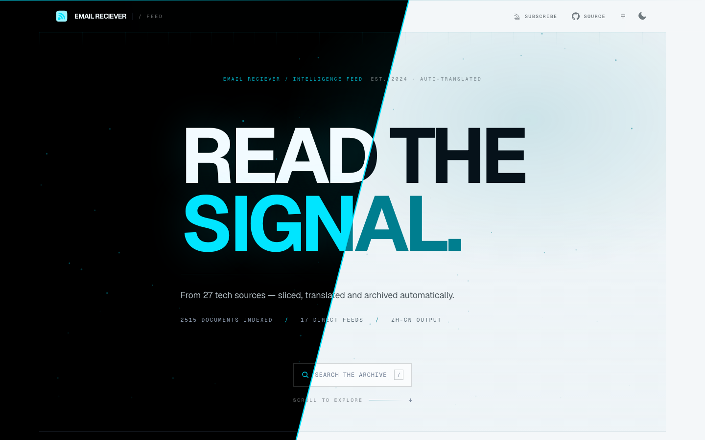
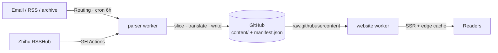
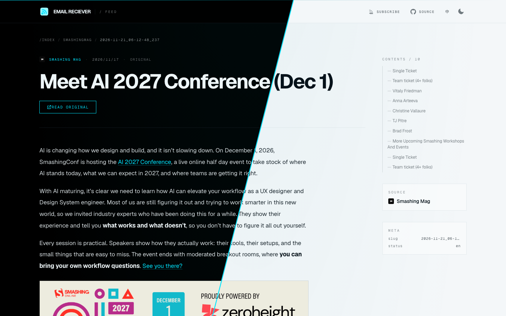
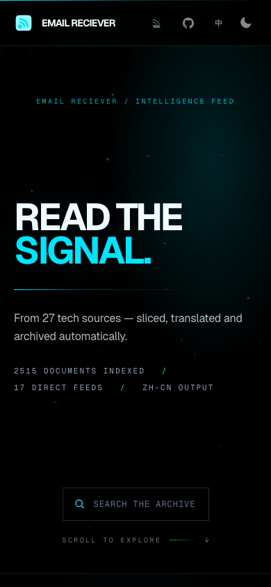

<div align="center">

# ▚ EMAIL RECIEVER

**Read the world's tech newsletters in Chinese.**

[](https://workers.cloudflare.com/)
[](https://tanstack.com/start)
[](https://react.dev/)
[](./LICENSE)

**[ Live site ](https://email-reciever-website.jiangjiangjiangxi.workers.dev/)** · **[ Subscribe ](https://email-reciever-website.jiangjiangjiangxi.workers.dev/subscribe)** · **[ Architecture ](./docs/architecture.md)** · **[ Design system ](./docs/design-system.md)**

**Language / 语言:** [中文](./README.md) · [English](./README.en.md)

</div>

---



## ▍What it does

An email, an RSS feed or an archive page goes in; a clean, fully translated Chinese Markdown article comes out.

- **Collect**: Gmail forwarding → Cloudflare Email Routing; RSS / archive pages → worker cron every 6h; GitHub Issue → single-article import
- **Process**: per-source slicing → code-block placeholders → MyMemory (keyless) → Workers AI → Google `gtx` fallback chain, with placeholder-multiset validation
- **Store**: `content/{author}/{timestamp}.md` + `manifest.json` on GitHub
- **Read**: TanStack Start fetches from the raw CDN at request time with a two-level cache; Active Theory-style cinematic UI, editorial reading rhythm on detail pages

> 2,500+ posts are not bundled at build time — that is why the project moved from Astro SSG to SSR.

## ▍Architecture



Key decision: content is read from `main` **at runtime**, so content must be pushed before deployment. `manifest.json` is the single source for the list page. See [Architecture](./docs/architecture.md).

## ▍Interface



The interface uses **Active Theory** visual language: a dark stage with one electric-cyan accent, zero radius, no CSS shadows, and one canvas particle set-piece; scrolling pushes the camera slowly forward. Detail pages keep the same system and borrow only beautiful-article's reading rhythm (TOC, progress, 68ch measure, colophon). Light mode is the inverted version of the same language — no black holes.



## ▍Layout

| Path                          | Purpose                                                             |
| ----------------------------- | ------------------------------------------------------------------- |
| `website/`                    | TanStack Start + React 19 site on Cloudflare Workers                |
| `cores/parser/`               | Worker: email / RSS / scraping, slicing, translation, GitHub writes |
| `packages/consts`             | Whitelist, RSS and archive source config (source-direct exports)    |
| `packages/turndown`           | HTML → Markdown converter (fork)                                    |
| `packages/server`             | Deno helper: local writes, batch replay, Discord notifications      |
| `packages/dts`                | Frontmatter type contract                                           |
| `scripts/migrate-content.mjs` | Legacy MDX migration / index rebuild / full backfill                |
| `content/`                    | Post bodies `{author}/{timestamp}.md`                               |
| `manifest.json`               | Post index (single source for the list page)                        |

## ▍Development

```bash
pnpm install          # install (postinstall builds the turndown fork)
pnpm dev              # local site
pnpm parser:dev       # local worker
pnpm parser:test      # worker tests
pnpm sr               # Deno helper service

pnpm check            # biome
pnpm format           # biome autofix
pnpm build            # site build + typecheck
```

## ▍Deployment

> Content is fetched from `main` at runtime, so **order matters**: push content first, then deploy.

```bash
# 1. commit and push content + code to main
git push origin main

# 2. wait for raw CDN propagation (~5min) and verify
curl -s https://raw.githubusercontent.com/email-reciever/website/main/manifest.json \
  | jq '.posts | length'

# 3. deploy the site (worker: email-reciever-website)
pnpm run deploy

# 4. deploy the parser (worker: subscribe-email)
pnpm run parser:deploy
```

Worker secrets: `REPO_TOKEN`, `ZHIHU_COOKIE` (`wrangler secret put`); do not set `ENV=dev` in production, or writes go to the local Deno service.

## ▍Scheduled jobs

| Job                  | Trigger                                             | Behaviour                                                                                |
| -------------------- | --------------------------------------------------- | ---------------------------------------------------------------------------------------- |
| Regular sync         | worker cron `0 */6 * * *`                           | newest un-ingested item per source                                                       |
| **History backfill** | worker cron `15 3 * * *` + `backfill-rss.yml` daily | walk oldest missing feed items, dedupe by GUID + manifest `origin_url`                   |
| Manual backfill      | `POST <worker>/rss?backfill=1`                      | trigger a full backfill round immediately                                                |
| **Reconcile**        | worker cron `45 4 * * *` + `reconcile-content.yml`  | repair empty bodies / missing translations; re-publish in place when source HTML changes |
| Zhihu                | `subscribe-zhihu.yml` every 7 days                  | RSSHub crawl                                                                             |

Backfill and reconcile are bound by the free Workers limits (50 subrequests / 10ms CPU per invocation), so they process one post per source per invocation, serially. A full round takes roughly 2–4 minutes.

## ▍Subscription & LLMs

- Our own RSS 2.0 feed: `/rss.xml` (ETag / 304, 5-minute cache); `/subscribe` lets visitors copy the URL and preview recent posts
- LLM indexes: `/llms.txt` (compact) and `/llms-full.txt` (full context); `robots.txt` explicitly welcomes GPTBot / ClaudeBot / Googlebot
- `sitemap.xml` is generated from the manifest with every post URL and `lastmod`
- Each article carries JSON-LD `Article` structured data

## ▍Index repair

If `manifest.json` drifts or shrinks unexpectedly:

```bash
pnpm run migrate:rebuild     # rebuild from content/**/*.md (compact JSON)
pnpm migrate                 # incrementally fold leftover src/content MDX
```

## License

MIT
