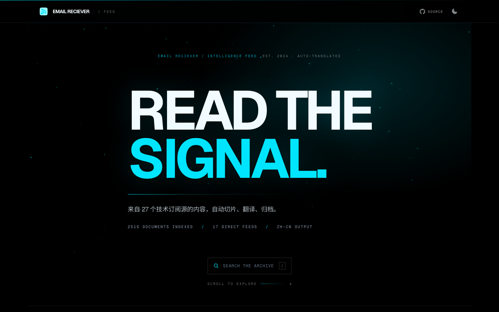
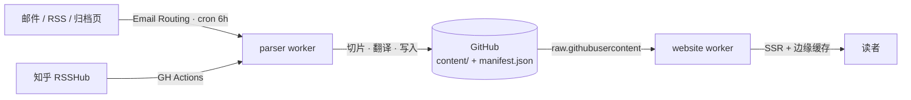
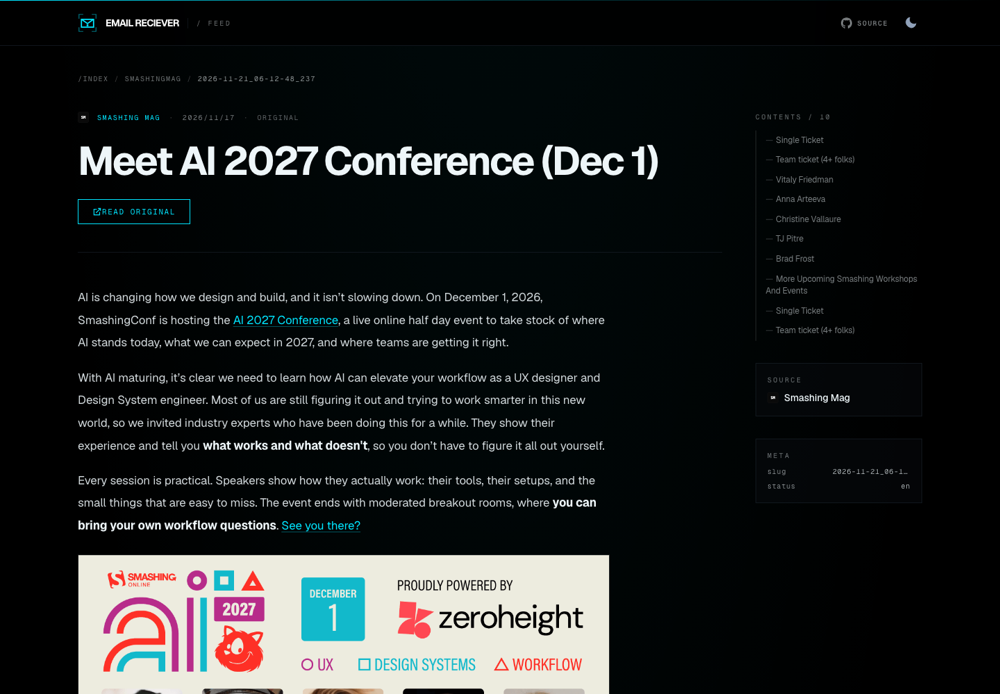
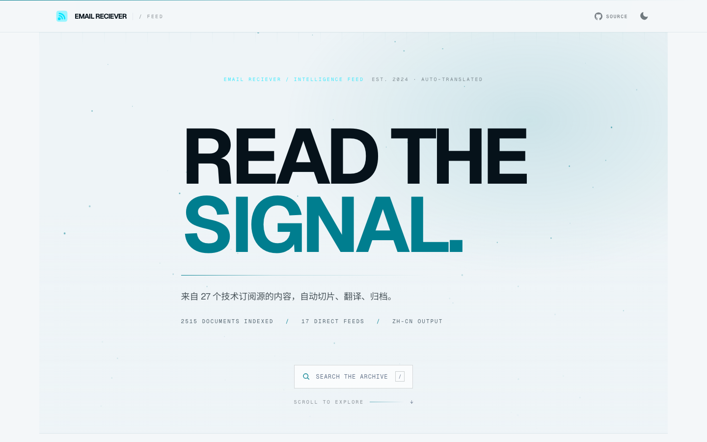
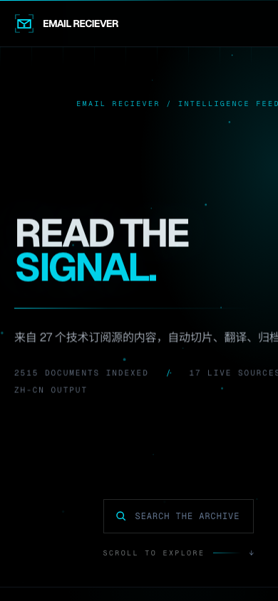

<div align="center">

# ▚ EMAIL RECIEVER

**把全世界的技术通讯，读成中文。**

[](https://workers.cloudflare.com/)
[](https://tanstack.com/start)
[](https://react.dev/)
[](./LICENSE)

**[ 在线站点 ](https://email-reciever-website.jiangjiangjiangxi.workers.dev/)** · **[ 订阅 ](https://email-reciever-website.jiangjiangjiangxi.workers.dev/subscribe)** · **[ 架构设计 ](./docs/architecture.md)** · **[ 视觉规范 ](./docs/design-system.md)**

**语言 / Language:** [中文](./README.md) · [English](./README.en.md)

</div>

---



## ▍它做什么

一封邮件、一个 RSS feed、一个归档页进来；一篇结构完整、已翻译成中文的 Markdown 文章出去。

- **收录**：Gmail 转发 → Cloudflare Email Routing；RSS / 归档页 → worker cron 每 6h 拉取；GitHub Issue → 单篇录入
- **处理**：按订阅源切片 → 保留代码块占位符 → MyMemory（免 key）→ Workers AI → Google `gtx` 三级翻译回退;占位符多重集校验保证代码块不被译坏
- **存储**：`content/{author}/{timestamp}.md` + `manifest.json`，全部落在 GitHub
- **阅读**：TanStack Start 在请求时从 raw CDN 取数，两级缓存；界面为 Active Theory 式电影感舞台，详情页用编辑式阅读节奏

> 2,500+ 篇文章不在构建期打包 —— 这正是从 Astro 全量 SSG 迁移到 SSR 的原因。

## ▍架构



核心取舍：内容在**运行时**从 `main` 分支读取，所以推送内容必须先于部署；索引 `manifest.json` 是列表页唯一数据源。详见 [架构设计](./docs/architecture.md)。

## ▍界面



界面采用 **Active Theory** 视觉语言：深色舞台 + 单一电光青强调色、零圆角、无 CSS 阴影、一处 canvas 粒子场景作为唯一高潮；滚动时镜头缓慢推进。详情页沿用同一套色板，只借用 beautiful-article 的编辑式阅读节奏（目录、进度、68ch 行宽、colophon）——不引入第二套视觉系统。浅色模式是同一套语言的反相版本，舞台、导航、页脚同步切换，不留黑洞。





## ▍目录

| 路径                          | 说明                                                      |
| ----------------------------- | --------------------------------------------------------- |
| `website/`                    | TanStack Start + React 19 站点，部署到 Cloudflare Workers |
| `cores/parser/`               | Worker：收信 / RSS / 爬取、切片、翻译、写入 GitHub        |
| `packages/consts`             | 白名单、RSS 源、归档源配置（源码直出）                    |
| `packages/turndown`           | HTML → Markdown 转换器（fork）                            |
| `packages/server`             | Deno 辅助服务：本地写入、批量补发、Discord 通知           |
| `packages/dts`                | frontmatter 类型契约                                      |
| `scripts/migrate-content.mjs` | 遗留 MDX 迁移 / 索引重建 / 全量回填                       |
| `content/`                    | 文章正文 `{author}/{timestamp}.md`                        |
| `manifest.json`               | 文章索引（列表页唯一数据源）                              |

## ▍开发

```bash
pnpm install          # 安装（postinstall 会构建 turndown fork）
pnpm dev              # 网站本地开发
pnpm parser:dev       # worker 本地开发
pnpm parser:test      # worker 测试
pnpm sr               # Deno 辅助服务

pnpm check            # biome
pnpm format           # biome 自动修复
pnpm build            # 网站构建 + 类型检查
```

## ▍部署

> 因为内容在运行时从 `main` 拉取，**顺序很重要**：先推内容，再部署网站。

```bash
# 1. 提交并推送内容 + 代码到 main
git push origin main

# 2. 等待 raw CDN 传播（~5min），确认数据到位
curl -s https://raw.githubusercontent.com/email-reciever/website/main/manifest.json \
  | jq '.posts | length'

# 3. 部署网站（worker: email-reciever-website）
pnpm run deploy

# 4. 部署 parser（worker: subscribe-email）
pnpm run parser:deploy
```

Worker secrets：`REPO_TOKEN`、`ZHIHU_COOKIE`（`wrangler secret put`）；`ENV` 不要设成 `dev`，否则写入会走本地 deno 服务。

## ▍定时任务

| 任务         | 触发                                               | 行为                                                           |
| ------------ | -------------------------------------------------- | -------------------------------------------------------------- |
| 常规同步     | worker cron `0 */6 * * *`                          | 每个源取最新 1 条未入库内容                                    |
| **历史回填** | worker cron `15 3 * * *` + `backfill-rss.yml` 每日 | 从最旧的缺失条目开始回填，按 `origin_url` 与 manifest 双重去重 |
| 手动回填     | `POST <worker>/rss?backfill=1`                     | 立即触发一轮全源回填                                           |
| **内容校正** | worker cron `45 4 * * *` + `reconcile-content.yml` | 修复空正文 / 缺译文;源 HTML 变化时原地更新同一 slug            |
| 知乎         | `subscribe-zhihu.yml` 每 7 天                      | RSSHub 抓取                                                    |

回填受 Workers 免费额度约束（50 subrequest / 10ms CPU 每次调用），所以按「每源每次 1 篇」串行推进；跑完一轮约 2–4 分钟。

## ▍订阅与大模型

- 本站自己的 RSS 2.0 源：`/rss.xml`（支持 ETag / 304，5 分钟缓存），页面 `/subscribe` 可复制订阅地址并预览最近文章
- 给大模型的索引：`/llms.txt`（精简）与 `/llms-full.txt`（完整上下文），`robots.txt` 显式允许 GPTBot / ClaudeBot / Googlebot
- `sitemap.xml` 由 manifest 动态生成，含全部文章 URL 与 `lastmod`
- 每篇文章有 JSON-LD `Article` 结构化数据（见详情页 head）

## ▍索引修复

若 `manifest.json` 漂移或异常缩小：

```bash
pnpm run migrate:rebuild     # 从 content/**/*.md 全量重建（写紧凑 JSON）
pnpm migrate                 # 增量收编 src/content 中遗留的 MDX
```

## License

MIT
