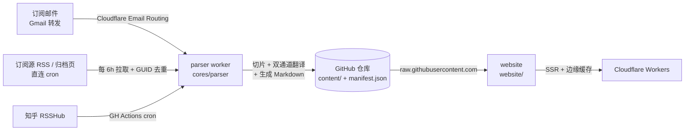

# Email Reciever

订阅自动翻译与归档站:Cloudflare Worker 通过邮件转发、RSS 直连或列表页爬取收取订阅内容 → 解析、经 Google 翻译 / Workers AI 双通道翻译成中文 Markdown → 存入本仓库 → [TanStack Start](https://tanstack.com/start) 网站运行时从 GitHub 读取渲染。

## 架构



- **内容不在构建期打包**(这也是本次重构的起因 —— 1800+ 篇文章全量 SSG 超出了 Cloudflare Pages 的构建限制),网站在请求时通过 raw CDN 拉取,两级缓存(edge cache + worker 内存)扛住流量。
- `manifest.json` 是全部文章的元数据索引,parser 每发布一篇就同步更新;列表页只读这一个文件。

## 目录

| 路径 | 说明 |
| --- | --- |
| `website/` | TanStack Start 站点(React 19 + @tanstack/markdown + Tailwind 4 + daisyUI 5),部署到 Cloudflare Workers |
| `cores/parser/` | Worker:接收邮件 / RSS 直连 / 归档页爬取、按订阅源切片、google gtx + Workers AI 翻译、写入仓库 |
| `packages/consts` | 订阅源白名单 / RSS 源清单等常量(parser 与 website 共享) |
| `packages/turndown` | HTML → Markdown 转换器(带自定义规则的 fork) |
| `packages/server` | Deno 辅助服务:本地写入、批量补发、Discord 通知 |
| `packages/dts` | frontmatter 等类型定义 |
| `content/` | 文章正文 `{author}/{timestamp}.md` |
| `manifest.json` | 文章索引(网站列表页数据源) |

## 开发

```bash
pnpm install          # 安装(根 package.json 管理工具链)

pnpm dev              # 网站本地开发
pnpm parser:dev       # worker 本地开发(wrangler dev)
pnpm parser:test      # worker 测试(vitest + workers pool)
pnpm sr               # deno 辅助服务

pnpm check            # biome lint / format 检查
pnpm format           # biome 自动修复
```

## 部署

```bash
pnpm deploy           # 网站构建 + wrangler deploy(Cloudflare Workers)
pnpm parser:deploy    # Email Worker 部署
```

Worker secret 通过 `wrangler secret put`(REPO_TOKEN / ZHIHU_COOKIE / ENV)管理,详见 `docs/architecture.md`。

## 提交新订阅源 / 收录文章

- 新订阅源:提 Issue 使用 `[Subscribe]` 模板
- 收录外部文章:提 Issue 使用 `[Recorder]` 模板,Worker 会抓取、翻译并在 Issue 下回评

## License

MIT
