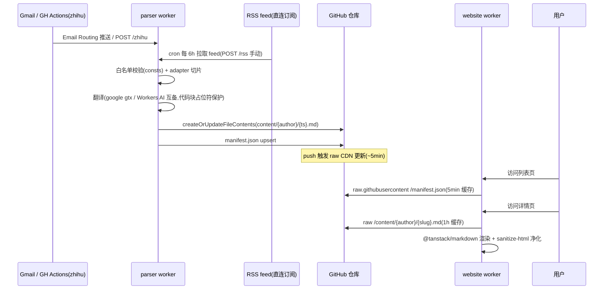

# 架构设计说明

> 2025-10 重构:从 Astro 静态站迁移到 TanStack Start SSR。本文记录重构后的架构、关键决策与已知取舍,后续改动涉及相关内容时请同步更新本文。

## 背景

旧架构:Astro 全量 SSG,2392 篇 MDX 在构建期全部渲染成静态页,产物超出 Cloudflare Pages 构建限制导致构建失败。此外旧内容格式为了兼容 Astro MDX 引入了大量转义 hack(`&lt;` → `<`、`{` → `&lcub;`、frontmatter 手工字符串拼接、标题里半角冒号替换为全角)。

## 数据流

## 内容格式(content v2)

- 路径:`content/{author}/{YYYY-MM-DD_HH-mm-ss_SSS}.md`,文件名即 slug(唯一、可排序、无特殊字符)
- frontmatter 由 parser 用 js-yaml 序列化(真实 YAML,不再手拼字符串)
- `date` 为 ISO 8601(UTC);不再有 `layout` 字段;原文不落库,`translated: true` 时正文即译文,翻译失败则存原文并标记 `translated: false`
- 类型契约:`packages/dts/src/markdown-extends.d.ts` 的 `Frontmatter`(parser 写入方与 website 读取方共享)

### manifest.json

列表页唯一数据源,仓库根目录,parser 每次发布后 upsert(按 `author + slug` 去重,按 `date` 倒序)。website 端 schema 见 `website/src/lib/types.ts`。

**已知取舍**:manifest 更新是 read-modify-write,两封邮件并发到达时后写会覆盖先写,丢失一条索引(文章本体不会丢)。订阅邮件频率极低,风险可接受;若发生漂移,本地重跑 `scripts/migrate-content.mjs --force` 可从文件全量重建。

## website(website/)

- **TanStack Start + React 19**,SSR 部署到 Cloudflare Workers(`@cloudflare/vite-plugin` + `wrangler.jsonc`)
- **取数**:server function(`createServerFn`)内读取 raw.githubusercontent.com,两级缓存:
  1. edge cache(`caches.default`)—— 跨实例、抗冷启动
  2. 模块级 Map —— 热流量零 IO;渲染后的 HTML 有独立 LRU(64 篇)
- **列表页**:`/` 全部状态进 URL search params(`?source=&q=&page=`),server 端过滤分页(只传回当页切片,首屏 payload 小、可分享、SEO 友好);源 tab + 搜索 + 分页为客户端交互
- **详情页**:`/post/$author/$slug`(与旧站路径一致,保留外链兼容);markdown 渲染:**@tanstack/markdown**(同步小体积 parser/render,语法档案覆盖 atx 标题/表格/任务列表/脚注,标题自动生成稳定 id)。`allowHtml` 放行旧内容里的 raw HTML,但它是**信任边界而非净化器**,因此输出恒过 **sanitize-html** 白名单(标签/属性/URL scheme/仅 text-align 样式)—— 内容来自第三方邮件,净化不可省。代码高亮走 **@tanstack/highlight** 的 markdown adapter(escaped token markup),github-light/dark 双主题 CSS 由 `createThemeCss` 生成、按 daisyUI `data-theme` 切换,内联注入页面
- **TanStack Query**:用于详情页"同源更多文章"模块(独立于路由 loader 的客户端缓存/去重)
- **样式**:Tailwind 4(CSS-first)+ daisyUI 5(`dim` 暗色为默认,可切 `light`),排版手写在 `app.css` 的 `.markdown-body`,代码高亮主题由 @tanstack/highlight 的 `createThemeCss` 按 data-theme 切换
- 路由树 `routeTree.gen.ts` 由 dev/build 时自动生成,**首次 dev/build 后纳入版本管理**

## parser(cores/parser)

- wrangler 4 + vitest 4(workers pool),biome 2 统一格式化(不再与 prettier 并存)
- `createBlog` 输出纯 markdown(不再生成 MDX/import/JSX 组件),发布后同步 upsert manifest
- `md()` 翻译函数返回 `{ content, translated }`:译文与原文相同时视为翻译失败,避免旧版"翻译失败仍标记已翻译"的误判
- 保留:邮件自转发协议(`[fw>sender]-` 前缀)、issue 录入流程、知乎 RSSHub 定时抓取(GH Actions cron → worker `/zhihu`)、R2 日志

### 翻译(provider 链,worker 内闭环)

翻译不依赖任何外部自部署服务,worker 内双 provider 互为 fallback,由 `TR_PROVIDER` 选择主通道:

- **`google`(默认,非 AI)**:直连 `translate.googleapis.com` 的 `gtx` 端点(免 key)—— 与旧管线是同一个引擎,砍掉的是让它不稳定的免费代理环节;分块 ≤1200 字符(GET URL 长度限制),顺带 300ms 节流
- **`ai`**:Workers AI instruct LLM(默认 `@cf/meta/llama-3.3-70b-instruct-fp8-fast`,`TR_MODEL` 可换),分块 ≤4000 字符;对 markdown 结构的遵循度更高,但依赖 CF AI 的可用性

结构保留机制(两 provider 共用):

1. `md()` 先用 remark-code-plugin 把全部 fenced code block 替换为位置占位符 `<P|line-col-offset/>`
2. 按段落空行分块后逐块翻译,每块做**占位符多重集校验**:不一致 → 重试(主 provider 1 次)→ 切换备 provider(1 次)→ 全部失败则整篇判为翻译失败
3. 失败时 `md()` 落回原文并标记 `translated: false`(用户可见该文未翻译)
4. remark-code-plugin 按位置还原真实代码块

> 注意:`gtx` 是 Google 的非官方端点,对数据中心 IP 可能限流(旧管线 Deno Deploy 遇到的正是这个),这正是保留 AI 兜底与 `TR_PROVIDER` 开关的原因 —— 若观察到大面积翻译失败,切到 `TR_PROVIDER=ai` 即可。本机网络无法直连 google 域名属预期,worker 部署在 Cloudflare 边缘不受影响。

### 直连订阅(已实施:RSS + 列表页爬取)

替代"依赖 Gmail 转发"的收信方式。两条发现通道汇入同一 ingest 管线(`utils/ingest.ts`:GUID 去重 → 发布 → 每条落盘):

**RSS feed**(`packages/consts/src/rss.ts`,全部实测验证):

- **newsletter 模式**:feed 条目即完整一期邮件(HTML 与邮件正文一致),复用既有邮件 adapter 切片 —— cooperpress 三刊 + react status(`/rss` 路径同系)、bytes(爬取,见下)
- **article 模式**:feed 条目是单篇文章,`html2md` 直转 —— cloudflareblog(`/rss`)、astro(`/rss.xml`)、reactdigest(`/newsletters.rss`,原生 feed)

**列表页爬取**(`packages/consts/src/archives.ts`,无 RSS 的源):

- **tyler(bytes.dev)**:归档页 `bytes.dev/archives` → 逐期页面;页面内含与邮件一致的切片标记(`Cool Bits logo` 等),复用 tyler adapter
- **alexkondov**:博客归档 `alexkondov.com/articles/`,条目链接有稳定的 `.article-link` 类;SSR 全文直接 article 模式
- 爬取前先对照去重列表,已发布的条目只花一次列表页请求

**调度**:cron(`[triggers]` 每 6h)+ 手动 `POST /rss`(GH workflow `subscribe-rss.yml`,secrets `WORKER_RSS_URL`)。

**未能直连的源**(继续走邮件链路):producthunt(归档页为客户端渲染,正文藏在 hydration JSON 里,cheerio 不可靠 —— 已探查确认)、medium、insidergithub、modular、arcupdate、syntaxfm、rnn。`us3.campaign-archive.com/feed` 是 Mailchimp 账户级 URL,裸路径 404,alexkondov 已改由其自有博客爬取。两条链路并存互不影响;已直连的源建议停掉对应邮件转发,避免同期双发。

## 共享包

- `packages/consts`:改为源码直出(`exports` 指向 `src/*.ts`),消费者均为 bundler 场景(vite/wrangler),不再需要 vite 构建出 dist
- `packages/turndown`:保持 fork + vite 构建(types 指向 `public/index.d.ts` 修复了类型从未生效的问题)

## 迁移(`scripts/migrate-content.mjs`)

一次性脚本:`src/content/**/*.mdx` → `content/**/*.md` + `manifest.json`。

- 丢弃 `<Detail>` 内的英文原文(既定决策,仓库体积减半),frontmatter 归一(drop `layout`、`origin_site` 冗余保留 zhihu 用法、`date` 从文件名时间戳重建为 ISO)
- 还原旧转义:`&lt;`→`<`、`&lcub;`→`{`
- 迁移后 `src/` 整体删除

> 已知边角:若某文章正文本身想展示字面 `<`,会被错误还原(极罕见,接受)

## 运维要点

- worker secrets:`REPO_TOKEN`(GitHub PAT)、`ZHIHU_COOKIE`、`ENV`(设 `dev` 时写入走本地 deno server)
- worker vars:`TR_PROVIDER`(`google` 非 AI 默认 / `ai`)、`TR_MODEL`(AI 模型覆盖)
- GitHub secrets:`WORKER_URL`(zhihu 手动触发)、`WORKER_RSS_URL`(RSS 手动补跑,`https://<worker>/rss`)
- 部署:`corepack pnpm deploy`(website → Cloudflare Workers,worker 名 `email-reciever-website`);`corepack pnpm parser:deploy`
- 若列表/详情冷渲染 CPU 超出免费额度(10ms),优先确认缓存命中率;必要时升级 Workers Paid
- 重建索引:本地 `corepack pnpm migrate --force`
